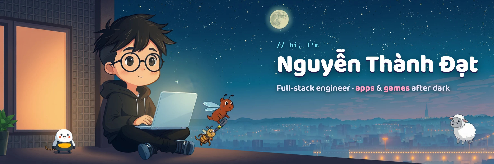
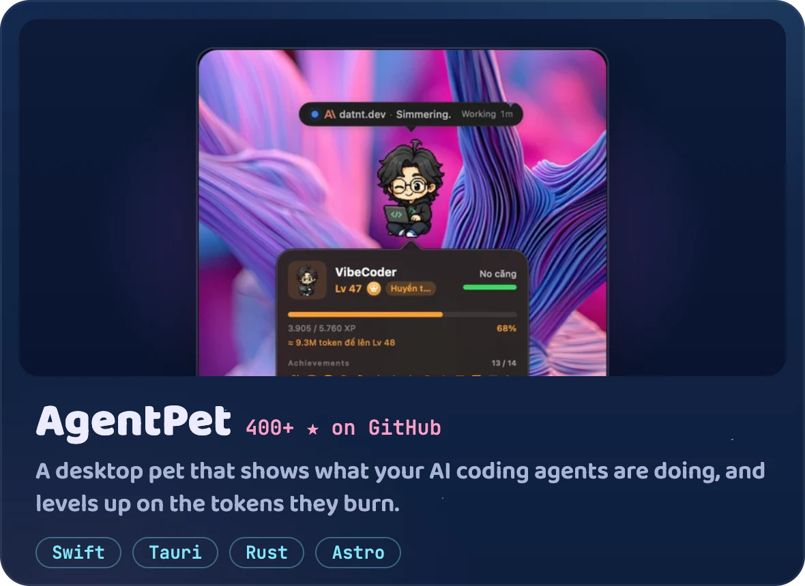
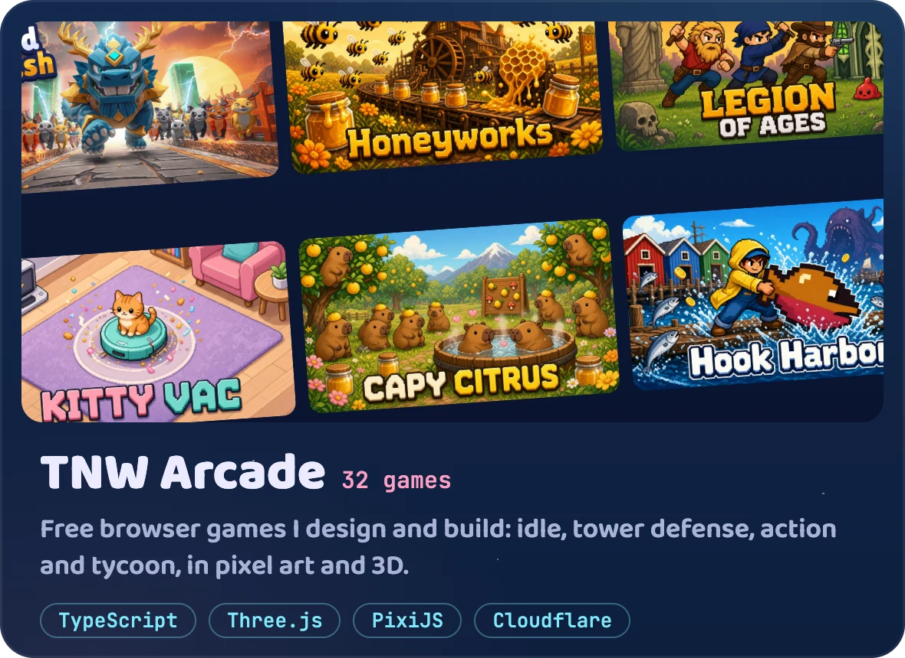
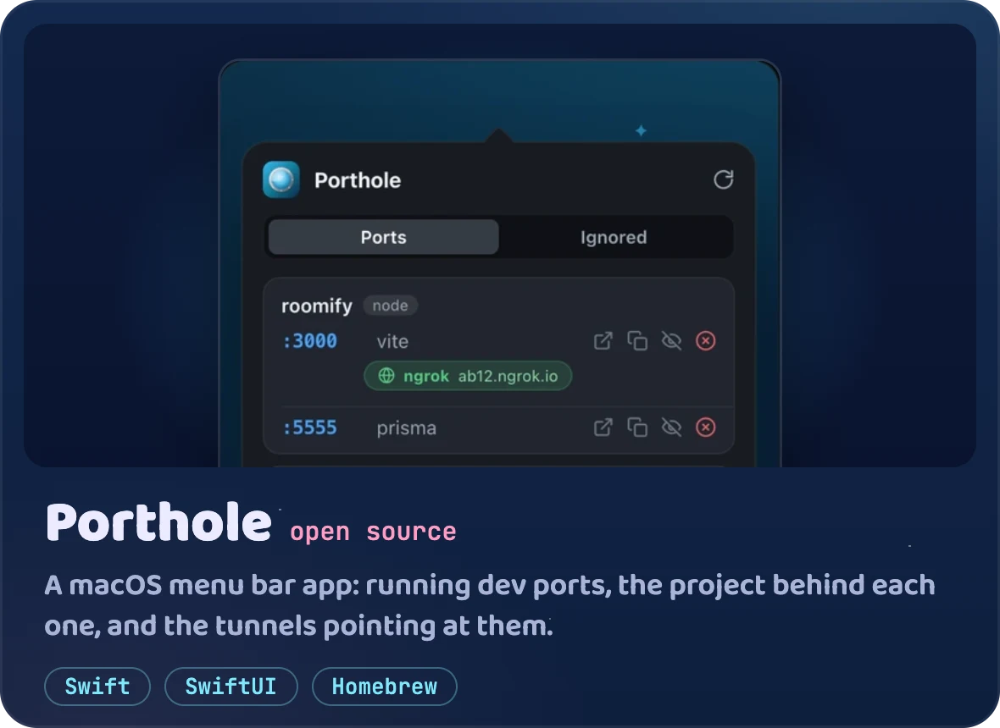
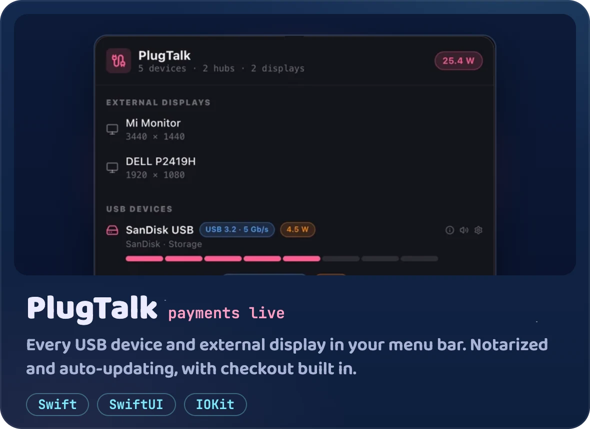
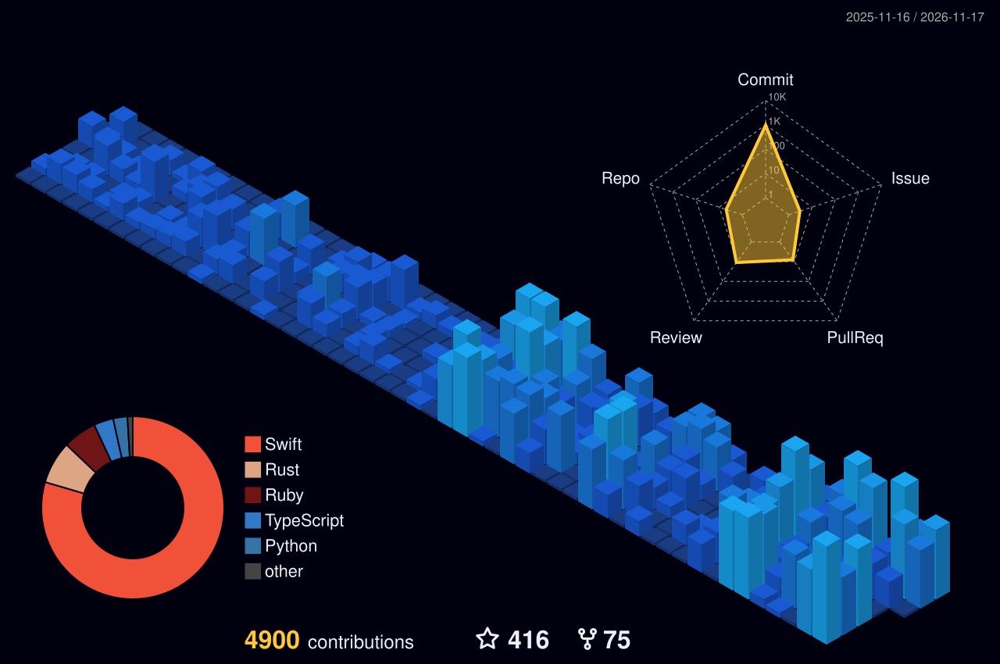

  

  
  
  
  
  

 

**Senior Full-Stack Engineer** in Hanoi, Vietnam. 6+ years building web products end to end with Node.js, NestJS,
React and Next.js, including Shopify Plus and headless commerce for Japanese clients, and Technical Lead for teams of
4-8 engineers.

After hours I ship my own things: native macOS apps in Swift, an open-source desktop pet for AI coding agents, an npm
package with real downloads, and a growing arcade of browser games.

| AgentPet on GitHub | Browser games | npm downloads / month | Experience |
|:------------------:|:-------------:|:---------------------:|:----------:|
| **400+ stars** | **32 live** | **780+** (embed-react) | **6+ years** |

 

  
  
  
  

  Also on npm: <a href="https://github.com/ntd4996/resize-iframe"><b>embed-react</b></a>, a React iframe that resizes to its content, with social embeds and a hardened Next.js proxy.

 

**Frontend**

**Backend & Database**

**Desktop, Mobile & Games**

**DevOps & Design**

**Shopify & AI**

     

 

<table width="100%">
  <tr>
    <td width="160" valign="top" align="center">
       
      
        
      Demetio 
      Hanoi, Vietnam
    </td>
    <td valign="top">
       
      <strong>Senior Full-Stack Developer · Technical Lead</strong>
        
      &nbsp;&nbsp;▸ Built <strong>20+ Shopify Plus</strong> stores for Japanese clients: Liquid, checkout extensions, metafield-driven UX 
      &nbsp;&nbsp;▸ Architected <strong>Headless Shopify</strong> storefronts with Hydrogen + Remix for performance-critical projects 
      &nbsp;&nbsp;▸ Integrated <strong>Claude & OpenAI APIs</strong> into e-commerce flows, saving 10+ hrs/week per client 
      &nbsp;&nbsp;▸ Full-stack delivery: <strong>NestJS, React, Next.js, PostgreSQL, Redis</strong>, GitHub Actions CI/CD 
      &nbsp;&nbsp;▸ Technical Lead for teams of <strong>4-8 engineers</strong>: planning, code review, hiring, mentoring interns to junior
    </td>
  </tr>
  <tr>
    <td width="160" valign="top" align="center">
       
      
        
      NAL Vietnam 
      Hanoi, Vietnam
    </td>
    <td valign="top">
       
      <strong>Software Developer</strong>
        
      &nbsp;&nbsp;▸ Developed web & mobile applications for <strong>Japanese enterprise clients</strong> 
      &nbsp;&nbsp;▸ Stack: <strong>React, Vue.js, React Native</strong>, REST APIs, push notifications 
      &nbsp;&nbsp;▸ Participated in full SDLC: requirements, development, QA, UAT, delivery
    </td>
  </tr>
</table>

  
  

 

  

  

 

  
  

